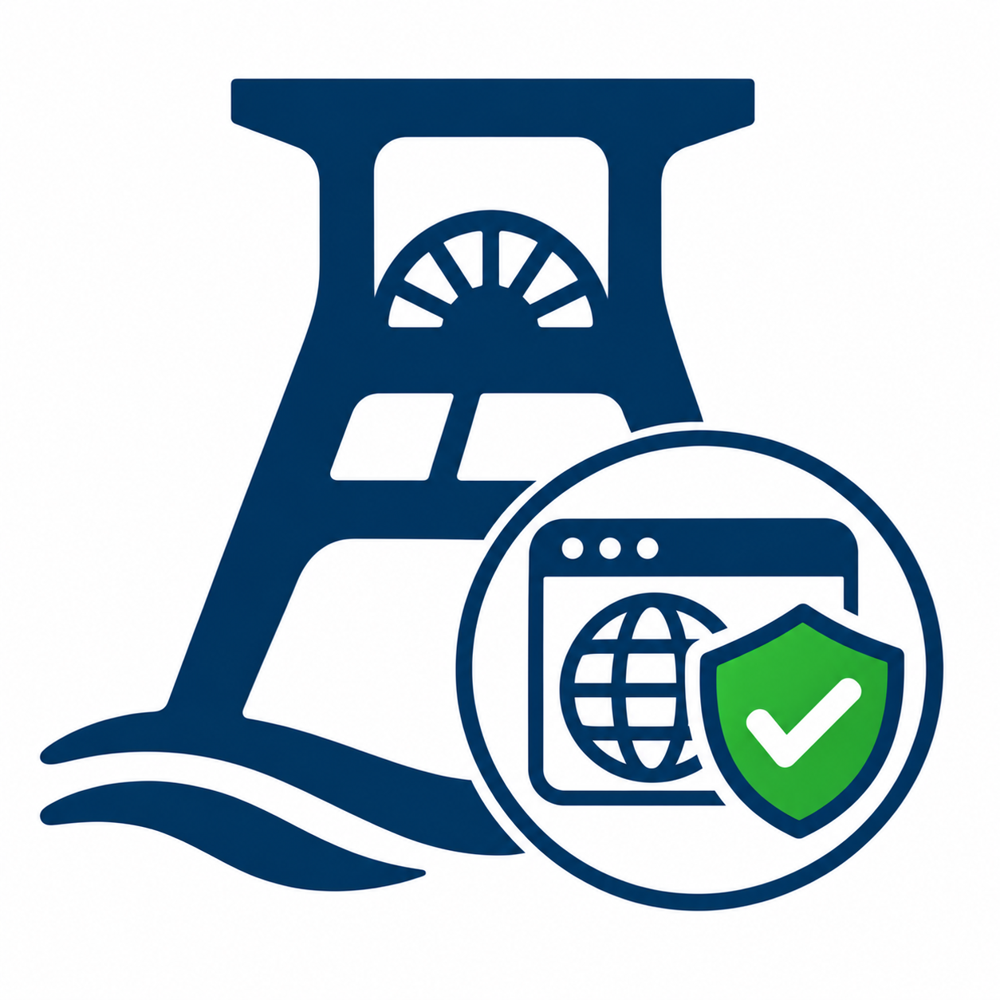

<div align="center">



# SiteCheck

**Checks your own websites from the outside for security and mail setup.**

[](https://github.com/ReneSchustek/SiteCheck/actions/workflows/ci.yml)
[](https://github.com/ReneSchustek/SiteCheck/releases/latest)
[](LICENSE)

[Deutsch](README.md) · **English**

</div>

A small checker for your **own** sites. It looks at an address from the outside and tells you in plain
language what is set up well and what is missing, written for people who are not admins as well. The
standard run makes only a few ordinary requests and DNS lookups; nothing is attacked and nothing is sent.
Requesting sensitive paths and the stress test only happen after you explicitly confirm, because both can
get your own connection blocked.

## Download

Ready-made packages for Windows (x64) are on the
[Releases](https://github.com/ReneSchustek/SiteCheck/releases/latest) page: the installer or the portable
ZIP, both self-contained (no runtime needed).

The files are not signed with a certificate, so Windows SmartScreen warns on first start ("Windows protected
your PC" → **More info** → **Run anyway**). Each release lists the **SHA-256 checksum** of every file so you
can verify your download:

```powershell
Get-FileHash .\SiteCheck-Setup-v0.2.0.exe -Algorithm SHA256
```

## Updates

The portable version updates itself: once a day it looks for a new version on GitHub, downloads it in the
background and installs it on the next start. Only a package with a valid signature is installed; without
one, the update is rejected. An installation in a read-only folder such as "Program Files" opens the release
page instead. You can turn this off under "About". The request goes to GitHub, never to a checked site.

Version 0.1.0 does not update itself yet. If you use it, download 0.2.0 once by hand; after that, new versions
arrive on their own.

## Protection against getting yourself blocked

A hosting provider cannot see that you are checking your own site. It only sees the pace and the paths, and
it blocks your entire connection for them, possibly including your mailboxes and for days. That is why:

- **Slow:** at most 40 requests per minute across all sites and at most 150 per domain and hour. Both also
  count across restarts and between the app and the console.
- **Stop at the first sign:** On 429, 503, a 403 on the home page or repeated missing answers, nothing more
  goes out and there is no retry. The domain then rests for an hour; only an explicit confirmation lifts this.
  Whatever did not run appears in the report as "not checked".
- **Sensitive paths only on request:** `.git`, `.env`, `/backup/` and the like only run after you confirm for
  exactly this run.
- **Batch run:** One site after another. If one rejects requests, the whole run ends.

A block cannot be ruled out entirely from the outside, because the provider's rules are unknown. If your
provider offers it, allowlisting your own address is the safest option.

## What it checks

**Web**
- Does http redirect permanently to https?
- Which encryption (TLS) is negotiated, how long is the certificate valid, does it match the address?
- Are the security headers set (CSP, HSTS, X-Frame-Options, nosniff, Referrer-Policy)?
- Is the session cookie clean (Secure, HttpOnly, SameSite)?
- Does the server reveal its version (Server, X-Powered-By)?
- Are sensitive files openly readable (`.git`, `.env`, `composer.json`, `.htaccess` …)? Only after confirmation.
- Does the server show an open directory listing on common paths? Only after confirmation.
- Is there a `/.well-known/security.txt` (RFC 9116) with a contact for security reports?

**DNS hardening**
- Is the domain signed with DNSSEC?
- Does a CAA record define which certificate authorities may issue certificates?
- Are there TLSA records (DANE) for the mail server?

**Mail setup** (the most common reason confirmation emails do not arrive)
- MX record present?
- SPF set, and how strictly does it end (`~all` or `-all`)?
- DKIM set, and is the key long enough?
- DMARC set: policy, report address (`rua`) and share (`pct`)?
- MTA-STS (including the policy over HTTPS), TLS-RPT and BIMI.
- Does the reverse DNS (PTR) of your own sending addresses match? Only individual addresses from SPF are
  checked, not network ranges; if sending goes through a provider, the report says so.
- A note if the site runs on a subdomain while SPF/DKIM exist only on the main domain.

**Honest about what it knows**
- Every finding is marked as measured or as an assumption "as seen from outside".
- If the site was unreachable, it says "not checked" instead of "OK". If your own machine gets no connection at
  all, the report points out that your own network is often the cause (an antivirus breaking HTTPS or a
  temporary IP block by the hosting provider).

**Stress test** (optional, active)
- Keeps many simultaneous requests open for a short time and measures response times and error rate.
- Hard-wired limits (at most 20 simultaneous requests, at most 60 seconds).
- Only runs after you explicitly confirm before **every** run that the site is yours.
- Ends at the first rejection. The domain then rests for at least a quarter of an hour.

## Your sites and history

You can save your own sites and check them all at once; each gets a traffic light from its worst finding. A
new run shows what has been added, stayed the same or been resolved since the previous one. The history can be
cleared.

## The report

Every result can be **copied** as text and **saved** as a styled HTML file (readable in light and dark). Each
finding has one clear sentence, a traffic light in words and, where it helps, specific advice with an example
to copy.

## Language and log

The app, findings, reports and console follow the Windows language: English on English Windows, German
otherwise. The history shows older runs in the language they were created in. The log is available in the app
under "Log" and is stored in `%LocalAppData%\SiteCheck\logs` (14 daily files).

## Requirements

- Windows 10 (1809 or later) or Windows 11
- .NET 10 SDK (for building), Visual Studio 2022/18 with the Windows App SDK workload

## Structure

Clean layering, dependencies point inward only:

```
SiteCheck.App          WinUI 3 interface (views, view models, composition root)
SiteCheck.Cli          thin console access to the same checking logic
SiteCheck.Application  processes: check run, stress test, report building, request guard
SiteCheck.Core         domain: finding model, severities, checks, contracts (no framework)
SiteCheck.Data         concrete access: HTTP, TLS, DNS, storage (JSON), update, log file
```

## Development

```bash
# Build and test
dotnet build SiteCheck.slnx -c Release
dotnet test tests/SiteCheck.Core.Tests/SiteCheck.Core.Tests.csproj -c Release
dotnet test tests/SiteCheck.Application.Tests/SiteCheck.Application.Tests.csproj -c Release
dotnet test tests/SiteCheck.Data.Tests/SiteCheck.Data.Tests.csproj -c Release
dotnet test tests/SiteCheck.App.Tests/SiteCheck.App.Tests.csproj -c Release --no-build -p:Platform=x64
```

Update packages are signed with `tools/sign-release.ps1`; the release job does this when the repository secret
`SITECHECK_SIGNING_KEY` is set. The private key stays outside the repository. `tools/new-signing-key.ps1` creates
a new pair. After a rotation, existing installations only trust the old key, so they have to install the
new version once by hand.

## Usage

**App:** start `SiteCheck.App`, enter the address at the top, "Check".

**Console:**

```bash
dotnet run --project src/SiteCheck.Cli -- https://example.com
```

`--sensitive-paths` also requests the sensitive paths, `--retry-during-halt` lifts a running rest period. Both
increase the risk of a block.

The console returns `1` as soon as there is a critical finding, `3` if the run was stopped and the report is
incomplete, and `0` otherwise, which is handy for scheduled runs.

## What it deliberately does NOT do

No attacks; only the explicitly confirmed stress test puts active load on your own site: no SQL injection, no
brute-forcing of passwords, no fuzzing. These belong in manual and code review:

- SQL injection (always prepared statements / placeholders)
- Script injection / XSS (escape output)
- CSRF tokens in forms that change data
- Issue a new session ID after login, limit failed attempts
- Store passwords only as a hash (bcrypt/argon2)
- Access rights / other users' data (IDOR)
- Securing file uploads

## Note

Only use it for sites you own or have permission to check. Many providers treat checks as an attack and
temporarily block the address, see [Protection against getting yourself blocked](#protection-against-getting-yourself-blocked).

## License

MIT, see [LICENSE](LICENSE).
