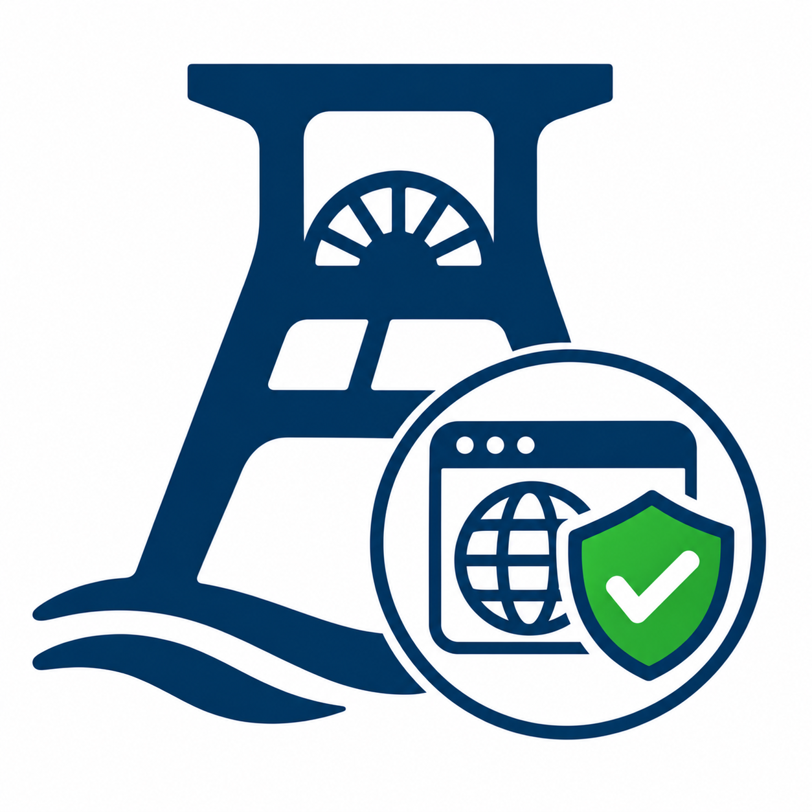

<div align="center">



# SiteCheck

**Prüft die eigenen Websites von außen auf Sicherheit und Mail-Einrichtung.**

[](https://github.com/ReneSchustek/SiteCheck/actions/workflows/ci.yml)
[](https://github.com/ReneSchustek/SiteCheck/releases/latest)
[](LICENSE)

**Deutsch** · [English](README.en.md)

</div>

Ein kleiner Prüfer für die **eigenen** Seiten. Er klopft eine Adresse von außen ab und sagt
in klarer Sprache, was gut eingestellt ist und was fehlt — gedacht auch für Leute, die keine
Admins sind. Der Standardlauf stellt nur wenige gewöhnliche Anfragen und DNS-Abfragen, es wird
nichts angegriffen und nichts verschickt. Die Abfrage heikler Pfade und der Stresstest laufen erst
nach ausdrücklicher Bestätigung, denn beide können den eigenen Anschluss sperren lassen.

## Herunterladen

Fertige Pakete für Windows (x64) liegen unter
[Releases](https://github.com/ReneSchustek/SiteCheck/releases/latest): der Installer oder das
portable ZIP, beide self-contained (keine Runtime nötig).

Die Dateien sind nicht mit einem Zertifikat signiert, deshalb warnt Windows SmartScreen beim ersten
Start („Der Computer wurde geschützt" → **Weitere Informationen** → **Trotzdem ausführen**). Zur
Sicherheit steht im Release die **SHA-256-Prüfsumme** jeder Datei; so lässt sich der Download prüfen:

```powershell
Get-FileHash .\SiteCheck-Setup-v0.2.0.exe -Algorithm SHA256
```

## Updates

Die portable Fassung aktualisiert sich selbst: Einmal am Tag sieht sie auf GitHub nach einer neuen Version,
lädt sie im Hintergrund und spielt sie beim nächsten Start ein. Eingespielt wird nur ein Paket mit gültiger
Signatur, ohne sie wird das Update abgewiesen. Eine Installation im schreibgeschützten Ordner „Programme“
öffnet stattdessen die Release-Seite. Abschalten lässt sich das unter „Über“. Die Abfrage geht an GitHub, nie
an eine geprüfte Seite.

Version 0.1.0 aktualisiert sich noch nicht selbst. Wer sie nutzt, lädt 0.2.0 einmal von Hand herunter; danach
kommen neue Versionen von allein.

## Schutz vor der eigenen Sperre

Ein Hoster sieht nicht, dass du deine eigene Seite prüfst. Er sieht nur das Tempo und die Pfade, und
er sperrt dafür deinen ganzen Anschluss, unter Umständen samt Postfächern und tagelang. Deshalb:

- **Langsam:** höchstens 40 Anfragen je Minute über alle Seiten und höchstens 150 je Domain und
  Stunde. Beides zählt auch über Neustarts und zwischen Oberfläche und Konsole.
- **Halt beim ersten Anzeichen:** Bei 429, 503, einer 403 auf der Startseite oder wiederholt
  ausbleibender Antwort geht nichts mehr hinaus, und es gibt keinen neuen Versuch. Die Domain ruht
  dann eine Stunde; aufheben lässt sich das nur ausdrücklich. Was nicht lief, steht im Bericht als
  „nicht geprüft“.
- **Heikle Pfade nur auf Wunsch:** `.git`, `.env`, `/backup/` und Ähnliches laufen nur nach einer
  Bestätigung für genau diesen Lauf.
- **Sammellauf:** Eine Seite nach der anderen. Weist eine ab, endet der ganze Lauf.

Ganz ausschließen lässt sich eine Sperre von außen nicht, denn die Regeln des Hosters sind unbekannt.
Bietet er es an, ist es am sichersten, die eigene Adresse freizuschalten.

## Was er prüft

**Web**
- Leitet http fest auf https um?
- Welche Verschlüsselung (TLS) wird ausgehandelt, wie lange gilt das Zertifikat, passt es zur Adresse?
- Sind die Schutz-Kopfzeilen gesetzt (CSP, HSTS, X-Frame-Options, nosniff, Referrer-Policy)?
- Ist das Sitzungs-Cookie sauber (Secure, HttpOnly, SameSite)?
- Verrät der Server seine Version (Server, X-Powered-By)?
- Sind heikle Dateien offen lesbar (`.git`, `.env`, `composer.json`, `.htaccess` …)? Nur nach Bestätigung.
- Zeigt der Server an gängigen Pfaden eine offene Verzeichnis-Auflistung? Nur nach Bestätigung.
- Gibt es eine `/.well-known/security.txt` (RFC 9116) mit Kontakt für Sicherheitsmeldungen?

**DNS-Härtung**
- Ist die Domain mit DNSSEC signiert?
- Legt ein CAA-Eintrag fest, welche Zertifizierungsstellen ausstellen dürfen?
- Gibt es für den Mailserver TLSA-Einträge (DANE)?

**Mail-Einrichtung** (der häufigste Grund für nicht ankommende Bestätigungsmails)
- MX-Eintrag vorhanden?
- SPF gesetzt, und wie streng endet er (`~all` oder `-all`)?
- DKIM gesetzt, und ist der Schlüssel lang genug?
- DMARC gesetzt: Richtlinie, Berichtsadresse (`rua`) und Anteil (`pct`)?
- MTA-STS (samt der Richtlinie über HTTPS), TLS-RPT und BIMI.
- Passt die Rückwärtsauflösung (PTR) der eigenen Versand-Adressen? Geprüft werden nur einzelne
  Adressen aus dem SPF, keine Netzbereiche; läuft der Versand über einen Anbieter, wird das benannt.
- Hinweis, wenn die Seite auf einer Subdomain läuft, SPF/DKIM aber nur auf der Hauptdomain liegen.

**Ehrlich eingeordnet**
- Jeder Befund steht als gesichert oder als Vermutung „aus Sicht von außen“ da.
- War die Seite nicht erreichbar, heißt es „nicht geprüft“ statt „in Ordnung“. Bekommt der eigene
  Rechner gar keine Verbindung, weist der Bericht darauf hin, dass oft das eigene Netz die Ursache ist
  (ein Virenschutz, der HTTPS aufbricht, oder eine zeitweise IP-Sperre des Hosters).

**Stresstest** (optional, aktiv)
- Hält für kurze Zeit viele gleichzeitige Anfragen offen und misst Antwortzeiten und Fehlerquote.
- Obergrenzen fest verdrahtet (höchstens 20 gleichzeitige Anfragen, höchstens 60 Sekunden).
- Läuft nur nach ausdrücklicher Bestätigung vor **jedem** Lauf, dass die Seite dir gehört.
- Endet bei der ersten Abweisung. Danach ruht die Domain mindestens eine Viertelstunde.

## Eigene Seiten und Verlauf

Die eigenen Seiten lassen sich speichern und auf einen Schlag prüfen; jede bekommt eine Ampel aus
ihrem schlimmsten Befund. Ein neuer Lauf zeigt, was seit dem vorigen dazugekommen, geblieben oder
behoben ist. Der Verlauf lässt sich leeren.

## Der Bericht

Jedes Ergebnis lässt sich als Text **kopieren** und als gestaltete **HTML-Datei speichern**
(hell und dunkel lesbar). Je Befund steht ein klarer Satz, eine Ampel in Worten und, wo es
hilft, der konkrete Rat samt Beispiel zum Übernehmen.

## Sprache und Protokoll

Oberfläche, Befunde, Berichte und Konsole folgen der Windows-Sprache: Englisch bei englischem Windows,
sonst Deutsch. Der Verlauf zeigt ältere Läufe in der Sprache, in der sie entstanden sind. Das Protokoll
steht in der App unter „Protokoll“ und liegt unter `%LocalAppData%\SiteCheck\logs` (14 Tagesdateien).

## Voraussetzungen

- Windows 10 (ab 1809) oder Windows 11
- .NET 10 SDK (für den Bau), Visual Studio 2022/18 mit der Windows-App-SDK-Arbeitslast

## Aufbau

Saubere Schichtung, Abhängigkeiten nur nach innen:

```
SiteCheck.App          WinUI-3-Oberfläche (Ansichten, ViewModels, Composition Root)
SiteCheck.Cli          schmaler Konsolen-Zugang auf derselben Prüflogik
SiteCheck.Application   Abläufe: Prüflauf, Lasttest, Berichtsbau, Sperrwache
SiteCheck.Core          Domäne: Befund-Modell, Stufen, Prüfungen, Verträge (ohne Framework)
SiteCheck.Data          konkrete Zugriffe: HTTP, TLS, DNS, Speicher (JSON), Update, Protokolldatei
```

## Entwicklung

```bash
# Bauen und prüfen
dotnet build SiteCheck.slnx -c Release
dotnet test tests/SiteCheck.Core.Tests/SiteCheck.Core.Tests.csproj -c Release
dotnet test tests/SiteCheck.Application.Tests/SiteCheck.Application.Tests.csproj -c Release
dotnet test tests/SiteCheck.Data.Tests/SiteCheck.Data.Tests.csproj -c Release
dotnet test tests/SiteCheck.App.Tests/SiteCheck.App.Tests.csproj -c Release --no-build -p:Platform=x64
```

Update-Pakete werden mit `tools/sign-release.ps1` signiert; der Release-Job erledigt das, wenn das
Repository-Secret `SITECHECK_SIGNING_KEY` gesetzt ist. Der private Schlüssel bleibt außerhalb des Repositorys.
`tools/new-signing-key.ps1` erzeugt ein neues Paar. Nach einem Wechsel vertrauen bestehende Installationen nur
dem alten Schlüssel und müssen die neue Fassung einmal von Hand einspielen.

## Benutzen

**Oberfläche:** `SiteCheck.App` starten, oben die Adresse eingeben, „Prüfen“.

**Konsole:**

```bash
dotnet run --project src/SiteCheck.Cli -- https://example.com
```

`--sensitive-paths` fragt auch die heiklen Pfade ab, `--retry-during-halt` hebt eine laufende
Ruhezeit auf. Beides erhöht das Risiko einer Sperre.

Rückgabewert der Konsole ist `1`, sobald ein kritischer Punkt dabei ist, `3`, wenn der Lauf
angehalten wurde und der Bericht unvollständig ist, sonst `0` — praktisch für einen geplanten Lauf.

**Vorführung:** `SiteCheck.exe --demo` startet mit Beispieldaten, etwa für Bildschirmfotos oder eine
Vorstellung. Die Seiten heißen `meine-seite.example`, `shop.example` und `blog.example`; geprüft wird
gegen feste Antworten, es geht keine einzige Anfrage ins Netz. Die Vorführung arbeitet in einem eigenen
Ordner, der bei jedem Start neu angelegt wird. Eigene Seiten, Verlauf und Sperrzeiten bleiben unberührt.
Der Fenstertitel trägt „Vorführung“.

## Was er bewusst NICHT macht

Keine Angriffe, nur der ausdrücklich bestätigte Stresstest belastet die eigene Seite aktiv:
keine SQL-Einschleusung, kein Durchprobieren von Passwörtern, kein Fuzzing. Diese Dinge gehören
von Hand und im Code geprüft:

- SQL-Einschleusung (immer vorbereitete Anweisungen / Platzhalter)
- Skript-Einschleusung / XSS (Ausgaben maskieren)
- CSRF-Token in ändernden Formularen
- Sitzungs-ID nach dem Login neu vergeben, Fehlversuche begrenzen
- Passwörter nur als Hash (bcrypt/argon2)
- Zugriffsrechte / fremde Daten (IDOR)
- Datei-Uploads absichern

## Hinweis

Nur für Seiten benutzen, die dir gehören oder für die du die Erlaubnis hast. Viele Anbieter
werten Prüfungen als Angriff und sperren die Adresse vorübergehend, siehe
[Schutz vor der eigenen Sperre](#schutz-vor-der-eigenen-sperre).

## Lizenz

MIT — siehe [LICENSE](LICENSE).

### Schriften

SiteCheck bringt seine Schriften mit und lädt keine aus dem Netz. Das Programm nutzt
[Roboto Flex](https://github.com/googlefonts/roboto-flex) und
[Roboto Mono](https://github.com/googlefonts/RobotoMono), beide unter der
[SIL Open Font License 1.1](https://openfontlicense.org). Die Lizenztexte liegen neben den
Schriftdateien unter `Assets/Fonts`. Der gespeicherte HTML-Bericht enthält verkleinerte Fassungen
beider Schriften, damit er auch beim Empfänger so aussieht wie im Programm.
