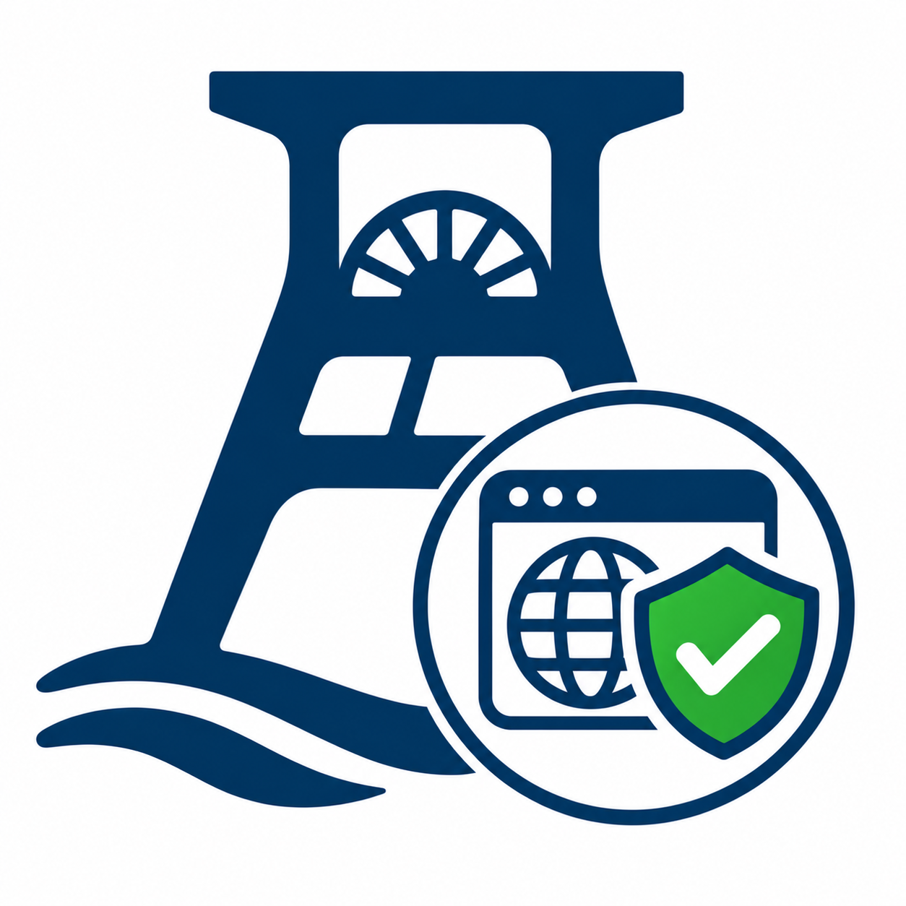

<div align="center">



# SiteCheck

**Prüft die eigenen Websites von außen auf Sicherheit und Mail-Einrichtung.**

[](https://github.com/ReneSchustek/SiteCheck/actions/workflows/ci.yml)
[](https://github.com/ReneSchustek/SiteCheck/releases/latest)
[](LICENSE)

</div>

Ein kleiner Prüfer für die **eigenen** Seiten. Er klopft eine Adresse von außen ab und sagt
in klarer Sprache, was gut eingestellt ist und was fehlt — gedacht auch für Leute, die keine
Admins sind. Die üblichen Prüfungen sind passiv: gewöhnliche Anfragen und DNS-Abfragen, es wird
nichts angegriffen und nichts verschickt. Nur der Stresstest belastet aktiv — und erst, nachdem
bestätigt wurde, dass die Seite dir gehört und selbst gehostet ist.

## Was er prüft

**Web**
- Leitet http fest auf https um?
- Welche Verschlüsselung (TLS) wird ausgehandelt, wie lange gilt das Zertifikat, passt es zur Adresse?
- Sind die Schutz-Kopfzeilen gesetzt (CSP, HSTS, X-Frame-Options, nosniff, Referrer-Policy)?
- Ist das Sitzungs-Cookie sauber (Secure, HttpOnly, SameSite)?
- Verrät der Server seine Version (Server, X-Powered-By)?
- Sind heikle Dateien offen lesbar (`.git`, `.env`, `composer.json`, `.htaccess` …)?

**Mail-Einrichtung** (der häufigste Grund für nicht ankommende Bestätigungsmails)
- MX-Eintrag vorhanden?
- SPF, DKIM und DMARC gesetzt?
- Passt die Rückwärtsauflösung (PTR) der Server-Adresse zur Domain?
- Hinweis, wenn die Seite auf einer Subdomain läuft, SPF/DKIM aber nur auf der Hauptdomain liegen.

**Stresstest** (optional, aktiv)
- Hält für kurze Zeit viele gleichzeitige Anfragen offen und misst Antwortzeiten und Fehlerquote.
- Obergrenzen fest verdrahtet (höchstens 20 gleichzeitige Anfragen, höchstens 60 Sekunden).
- Läuft nur nach ausdrücklicher Bestätigung vor **jedem** Lauf, dass die Seite dir gehört.

## Der Bericht

Jedes Ergebnis lässt sich als Text **kopieren** und als gestaltete **HTML-Datei speichern**
(hell und dunkel lesbar). Je Befund steht ein klarer Satz, eine Ampel in Worten und, wo es
hilft, der konkrete Rat samt Beispiel zum Übernehmen.

## Voraussetzungen

- Windows 10 (ab 1809) oder Windows 11
- .NET 10 SDK (für den Bau), Visual Studio 2022/18 mit der Windows-App-SDK-Arbeitslast

## Aufbau

Saubere Schichtung, Abhängigkeiten nur nach innen:

```
SiteCheck.App          WinUI-3-Oberfläche (Ansichten, ViewModels, Composition Root)
SiteCheck.Cli          schmaler Konsolen-Zugang auf derselben Prüflogik
SiteCheck.Application   Abläufe: Prüflauf, Lasttest, Berichtsbau
SiteCheck.Core          Domäne: Befund-Modell, Stufen, Prüfungen, Verträge (ohne Framework)
SiteCheck.Data          konkrete Zugriffe: HTTP, TLS, DNS, Speicher (JSON)
```

## Entwicklung

```bash
# Bauen und prüfen
dotnet build SiteCheck.slnx -c Release
dotnet test tests/SiteCheck.Core.Tests/SiteCheck.Core.Tests.csproj -c Release
dotnet test tests/SiteCheck.Application.Tests/SiteCheck.Application.Tests.csproj -c Release
dotnet test tests/SiteCheck.Data.Tests/SiteCheck.Data.Tests.csproj -c Release
dotnet test tests/SiteCheck.App.Tests/SiteCheck.App.Tests.csproj -c Release
```

## Benutzen

**Oberfläche:** `SiteCheck.App` starten, oben die Adresse eingeben, „Prüfen“.

**Konsole:**

```bash
dotnet run --project src/SiteCheck.Cli -- https://example.com
```

Rückgabewert der Konsole ist `1`, sobald ein kritischer Punkt dabei ist, sonst `0` — praktisch
für einen geplanten Lauf.

## Was er bewusst NICHT macht

Keine aktiven Angriffe außer dem ausdrücklich bestätigten Stresstest gegen die eigene Seite:
keine SQL-Einschleusung, kein Durchprobieren von Passwörtern, kein Fuzzing. Diese Dinge gehören
von Hand und im Code geprüft:

- SQL-Einschleusung (immer vorbereitete Anweisungen / Platzhalter)
- Skript-Einschleusung / XSS (Ausgaben maskieren)
- CSRF-Token in ändernden Formularen
- Sitzungs-ID nach dem Login neu vergeben, Fehlversuche begrenzen
- Passwörter nur als Hash (bcrypt/argon2)
- Zugriffsrechte / fremde Daten (IDOR)
- Datei-Uploads absichern

## Hinweis

Nur für Seiten benutzen, die dir gehören oder für die du die Erlaubnis hast. Viele Anbieter
werten schon viele schnelle Anfragen als Angriff und sperren die Adresse vorübergehend.

## Lizenz

MIT — siehe [LICENSE](LICENSE).
